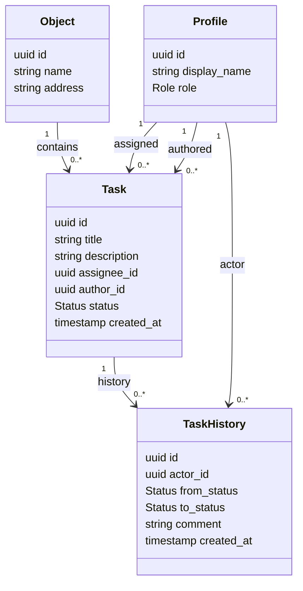
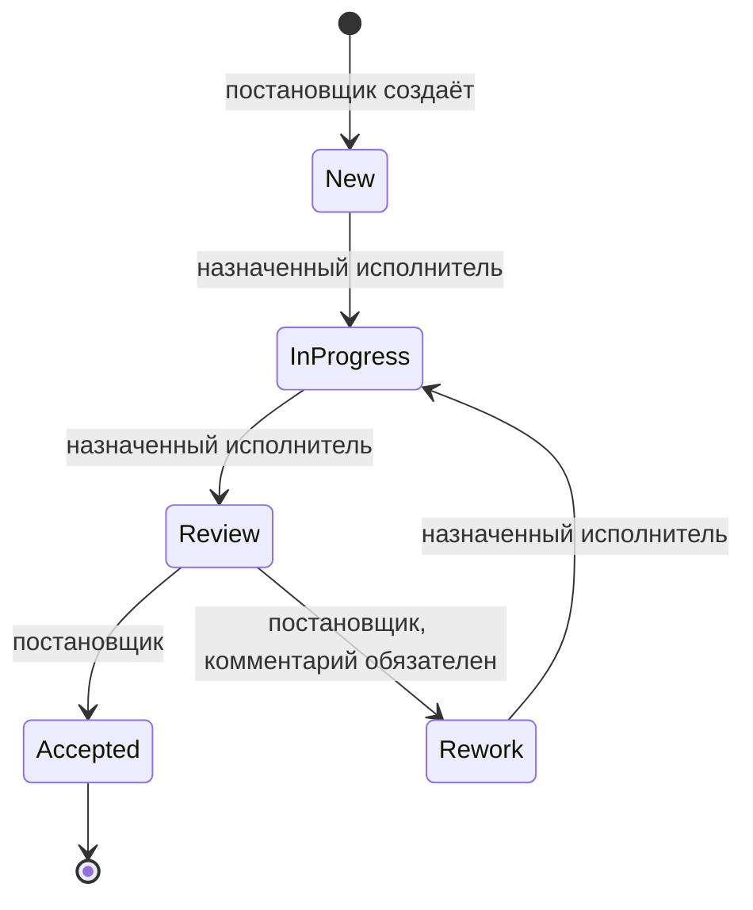
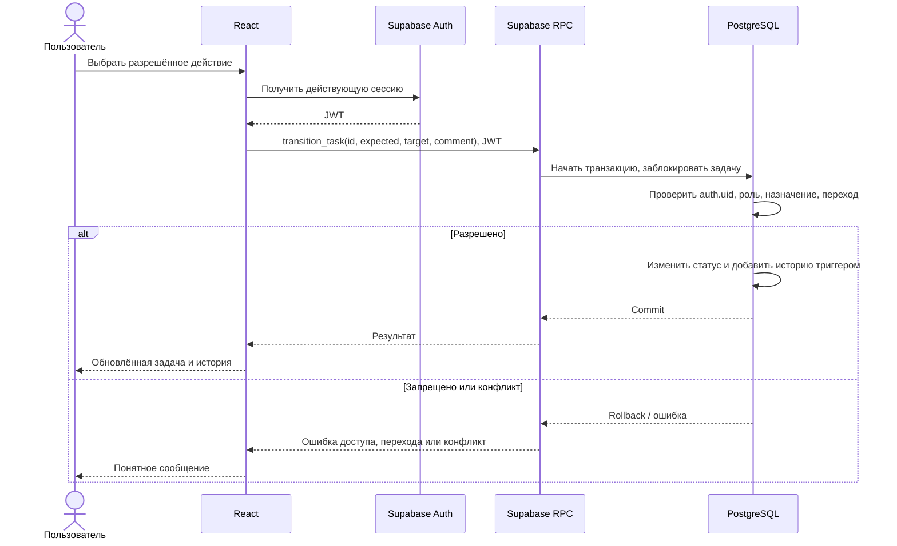
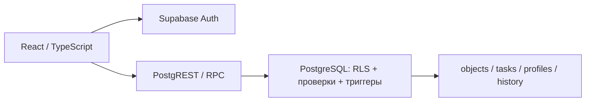

# UML Troast
Предложенная архитектура на основании ТЗ. Mermaid-блоки можно открыть в редакторе с поддержкой Mermaid.

## Диаграмма классов

## Состояния задачи

## Последовательность изменения статуса

## Компоненты

